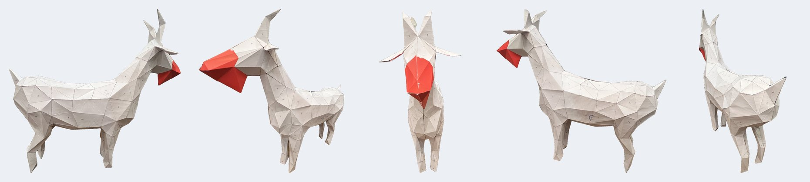

# Low-poly Goat Papercraft 🐐

A free, printable **low-poly goat** to cut out and glue from paper and cardboard — just in time for the **Year of the Goat (2027)**.
Two sizes on A4 sheets, plus an open-source generator to make your own size.

**Build status:** the large goat (v2) has been built and checked in paper. The small goat (v1) comes from the same generator and passes the same geometric checks, but has not been built yet — your photos and feedback are welcome.

**[Русская версия → README.ru.md](README.ru.md)**




*The large goat (v2) as built: plain 80 g/m² office paper glued onto cardboard, the muzzle pieces cut from red paper.*

## Download the pattern

| | Small goat (v1) | Large goat (v2) |
|---|---|---|
| Height at withers | 30 cm | 52 cm |
| Height to horn tips | 46 cm | 80 cm |
| Length | 49 cm | 85 cm |
| Pieces | 34 (17 mirrored L/R pairs) | 66 (33 pairs) |
| A4 sheets | 3 instruction pages + 10 | 3 instruction pages + 29 |
| Glue tab | 7 mm | 10 mm |
| Material | 160 g/m² card, or 80 g/m² paper on thin cardboard | 80–160 g/m² paper glued onto cardboard |
| PDF | [English](patterns/v1/goat_pattern_v1_en.pdf) · [Русский](patterns/v1/goat_pattern_v1_ru.pdf) | [English](patterns/v2/goat_pattern_v2_en.pdf) · [Русский](patterns/v2/goat_pattern_v2_ru.pdf) |

Each PDF contains an assembly map (the model coloured by piece, with piece numbers), a legend, step-by-step instructions, a parts list and a note on how to close the figure, followed by the pattern sheets at 1:1 scale.

## Quick start

1. **Print** on A4 (not Letter) at **100 %** ("Actual size"). Check the 50 mm bar in the sheet header with a ruler.
2. **Material:** glue plain 80 g/m² printouts face up onto thin cardboard with a dry glue (glue stick, spray, double-sided film), or print the small goat directly on 160 g/m² card.
3. **Score** every fold line along a metal ruler (wooden stick, empty ballpoint pen or embossing stylus) — *before* cutting.
4. **Cut** along solid lines with a craft knife; keep the grey tabs.
5. **Fold:** dash-dot = mountain (away from you), dashed = valley (towards you), tabs inwards.
6. **Glue** edges with the same number. Use fast glue — superglue gel or contact cement; white PVA dries too slowly.
7. **Order:** head → front legs → hind legs → sides from hind to front legs → join the two halves along the back → attach the head → close the belly last. On the belly seam all tabs are on the left pieces, so the right half simply lies over them.

Full guide: [docs/assembly.en.md](docs/assembly.en.md).

## Make your own size

The generator builds the 3D model, unfolds it, adds tabs and edge numbers, lays the pieces out on A4 and writes the PDF.
**A PDF is written only if every geometric check passes**: edge lengths match the 3D model, no piece overlaps itself, every edge number appears exactly twice, every seam has a glue tab, left and right pieces are exact mirrors, every piece fits on A4.

```bash
git clone https://github.com/DymkoVS/lowpoly-goat-papercraft
cd lowpoly-goat-papercraft
python3 -m venv .venv
.venv/bin/pip install -r requirements.txt          # Windows: .venv\Scripts\pip ...

.venv/bin/python goat/build.py --preset v1          # rebuild the small goat
.venv/bin/python goat/build.py --preset v2          # rebuild the large goat (built and checked)
.venv/bin/python goat/build.py --total-height 60 --faces 400 --max-edge 150 --tab 10 --version my60
```

Output goes to `out/<version>/`: PDFs in Russian and English, the assembly map, model pictures and `goat.obj`.

| Option | Meaning |
|---|---|
| `--preset v1` / `v2` | settings of the published patterns (see table above) |
| `--height` / `--total-height` | size: height at withers, or to the horn tips, in cm |
| `--faces` | number of triangles. Fewer = easier to build; below ~280 the horns turn into stubs |
| `--max-edge` | longest edge on paper, mm. Longer edges are split so pieces fit on A4 (use 150 for goats above ~50 cm) |
| `--tab` | glue tab height, mm (7 for small, 10 for large) |
| `--lang` | PDF languages, default `ru,en` |
| `--version` | label in the title and file names |

Recommended: **20–55 cm at the withers**. Smaller goats get very fiddly horn and ear tips; the generator prints a warning. Building takes 1.5–5 minutes.

Tested with Python 3.12 on macOS. Windows and Linux should work (pure Python dependencies with wheels), but have not been tested yet — reports welcome.

## How it works

1. **Model** — the goat is a signed distance field built from ellipsoids and capsules (body, neck, head, legs, ears, horns, tail), meshed with marching cubes, decimated to a few hundred triangles and mirrored for perfect symmetry.
2. **Unfolding** — faces are grouped into anatomical regions; within each region pieces are grown greedily, with hundreds of randomised attempts per region and the best one kept. Only the left half is unfolded; right pieces are exact mirrors.
3. **Tabs and numbers** — every cut edge gets a number and a tab, trimmed where space is tight. Convex edges are mountain folds, concave edges valley folds (the printed side is the outside of the goat).
4. **Layout** — pieces are packed by their real outline (1 mm raster + FFT convolution) in several orders; the fewest sheets win.

Details (in Russian): [docs/algorithm.ru.md](docs/algorithm.ru.md).

## Licence

- **Patterns** (PDF, pictures, 3D model in `patterns/`, photos in `docs/img/`): [CC BY 4.0](LICENSE-PATTERN.txt). Use, share, adapt — also commercially (workshops, classes, kits) — as long as you credit "Low-poly Goat Papercraft by DymkoVS" with a link to this repository.
- **Code** (`goat/`): [MIT](LICENSE).
- **Fonts** (`goat/fonts/`): DejaVu, see [LICENSE_DEJAVU](goat/fonts/LICENSE_DEJAVU).

Built with the help of [Claude](https://claude.ai) (Anthropic). Photos of your goats are very welcome in Issues!
