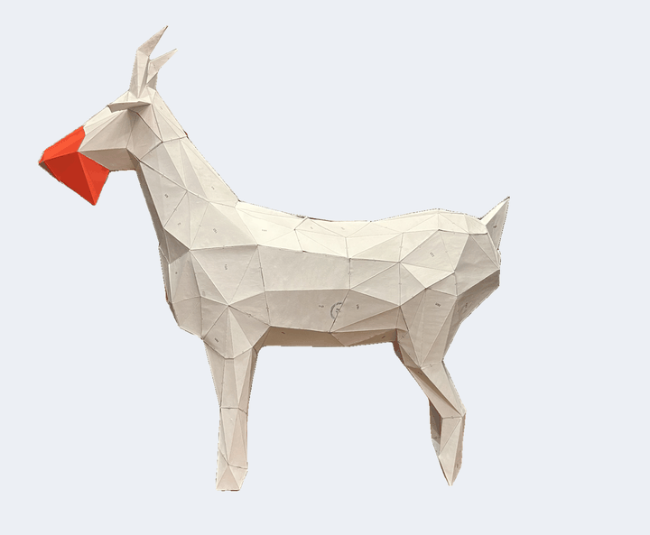
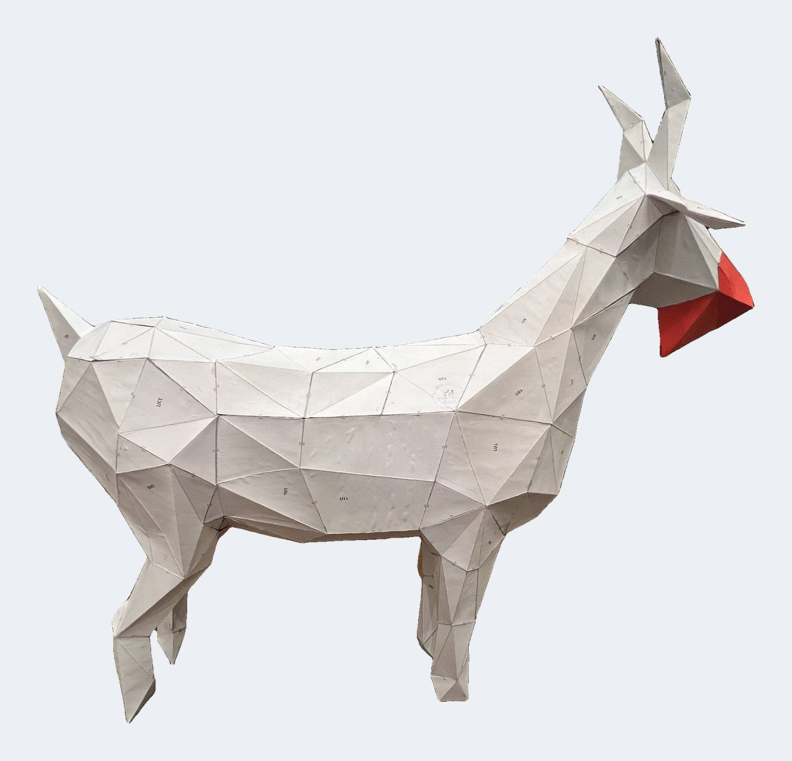
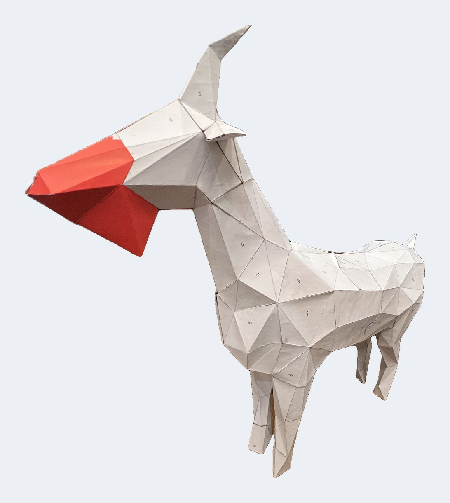
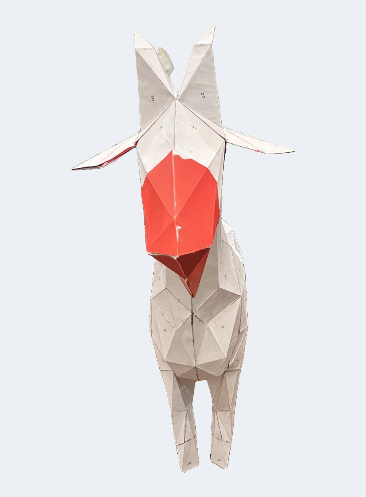
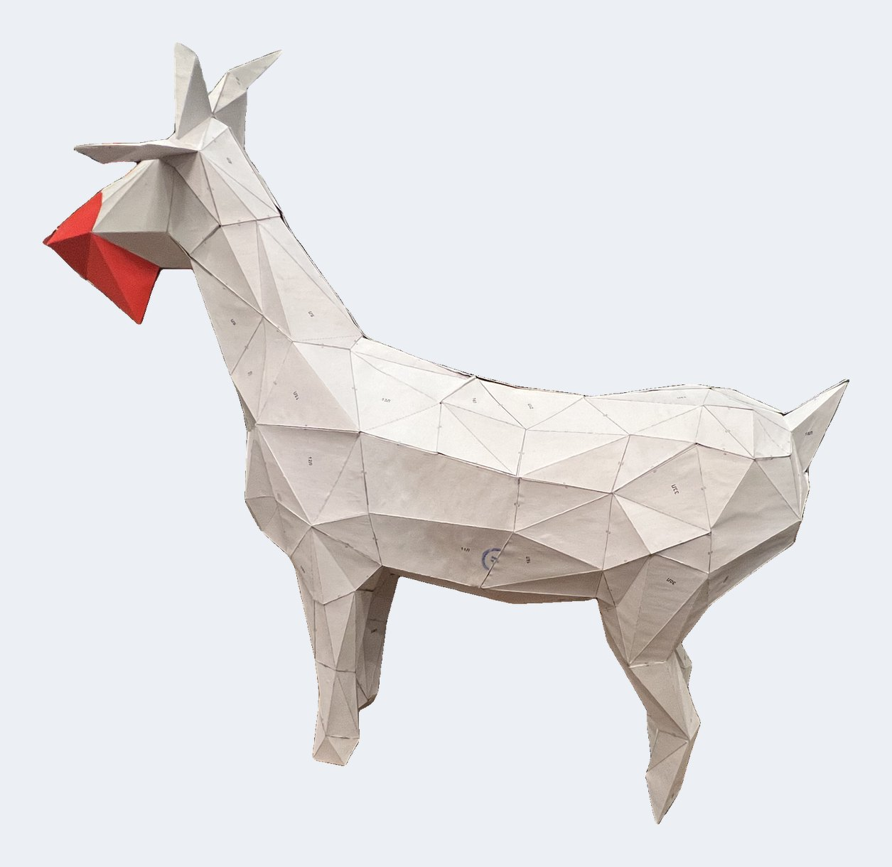
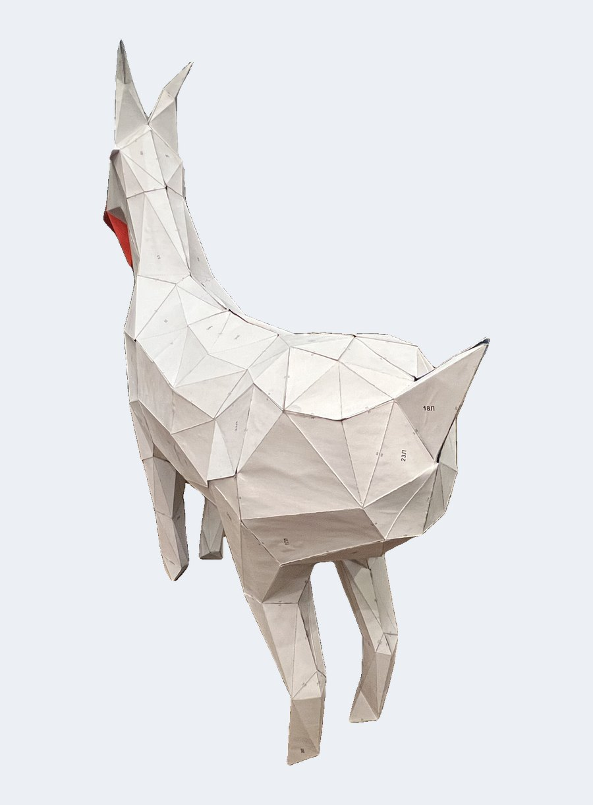
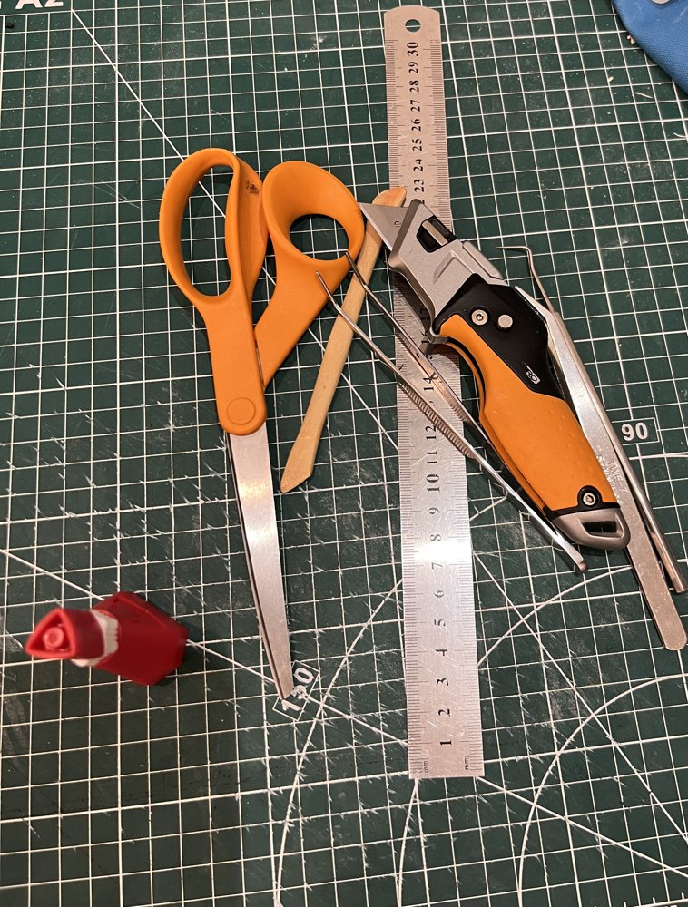

# Коза low-poly — выкройка из бумаги 🐐

Бесплатная полигональная **коза из бумаги и картона**: распечатать, вырезать, склеить — как раз к **году Козы (2027)**.
Два размера на листах A4 и открытый генератор, чтобы рассчитать свой размер.

**Что проверено сборкой:** большая коза (v2) собрана из бумаги и проверена. Малая коза (v1) сделана тем же генератором и проходит те же проверки геометрии, но сборкой ещё не проверялась — будем рады вашим фото и отзывам.

**[English version → README.md](README.md)**



*Большая коза (v2) в сборке: обычная офисная бумага 80 г/м², наклеенная на картон; морда вырезана из красной бумаги. Видео для соцсетей: [goat_spin.mp4](docs/media/goat_spin.mp4).*

Нажмите на фото, чтобы открыть в полном размере:

| [](docs/img/goat_left.jpg) | [](docs/img/goat_front_right.jpg) | [](docs/img/goat_front.jpg) | [](docs/img/goat_right_rear.jpg) | [](docs/img/goat_rear.jpg) |
|---|---|---|---|---|

## Скачать выкройку

| | Малая коза (v1) | Большая коза (v2) |
|---|---|---|
| Высота в холке | 30 см | 52 см |
| Высота по рогам | 46 см | 80 см |
| Длина | 49 см | 85 см |
| Деталей | 34 (17 зеркальных пар Л/П) | 66 (33 пары) |
| Листов A4 | 3 страницы инструкции + 10 | 3 страницы инструкции + 29 |
| Клапан | 7 мм | 10 мм |
| Материал | бумага 160 г/м² или 80 г/м² на тонком картоне | бумага 80–160 г/м², наклеенная на картон |
| PDF | [Русский](patterns/v1/goat_pattern_v1_ru.pdf) · [English](patterns/v1/goat_pattern_v1_en.pdf) | [Русский](patterns/v2/goat_pattern_v2_ru.pdf) · [English](patterns/v2/goat_pattern_v2_en.pdf) |

В каждом PDF:
- карта сборки: модель, раскрашенная по деталям, с номерами;
- обозначения линий;
- порядок работы;
- список деталей и как закрыть фигуру;
- листы с деталями в масштабе 1:1.

## Что понадобится



Инструменты, которыми собиралась большая коза:

- принтер (A4), обычная бумага 80 г/м², тонкий картон, клеящий карандаш, чтобы наклеить распечатки;
- коврик для резки, металлическая линейка (30 см), строительный или макетный нож, ножницы;
- деревянная палочка для биговки линий сгиба;
- два пинцета, прямой и изогнутый, — для клапанов в тесных местах;
- быстрый клей: суперклей-гель или контактный (ПВА сохнет слишком долго).

<br clear="right">

## Коротко о сборке

1. **Печать** — формат A4 (не Letter!), масштаб **100 %**. Проверьте линейкой отрезок 50 мм в шапке листа.
2. **Материал** — обычная бумага 80 г/м², наклеенная лицом наружу на тонкий картон сухим клеем (клеящий карандаш, аэрозоль, двусторонняя плёнка). Малую козу можно печатать сразу на плотной бумаге 160 г/м².
3. **Биговка** — до вырезания продавить все линии сгиба по металлической линейке: деревянной палочкой, пустой ручкой или стилусом.
4. **Вырезание** — ножом по сплошным линиям, серые клапаны не отрезать.
5. **Сгибы** — штрих-пунктир: «гора» (от себя); пунктир: «долина» (на себя); клапаны — внутрь.
6. **Клей** — края с одинаковыми номерами. Нужен быстрый клей: суперклей-гель или контактный. ПВА сохнет слишком долго.
7. **Порядок** — голова → передние ноги → задние ноги → бока от задних ног к передним → соединить половины по спине → приклеить голову → последним закрыть живот. На шве по животу все клапаны стоят на левых деталях, правая половина просто ложится сверху.

Подробно — [docs/assembly.ru.md](docs/assembly.ru.md).

## Свой размер

Генератор сам строит 3D-модель, разворачивает её, добавляет клапаны и номера рёбер, раскладывает детали на A4 и выпускает PDF.

**PDF создаётся, только если пройдены все проверки геометрии:**
- длины рёбер совпадают с 3D-моделью;
- детали не налезают сами на себя;
- каждый номер ребра встречается ровно дважды;
- у каждого шва есть клапан;
- левые и правые детали зеркальны;
- каждая деталь помещается на A4.

```bash
git clone https://github.com/DymkoVS/lowpoly-goat-papercraft
cd lowpoly-goat-papercraft
python3 -m venv .venv
.venv/bin/pip install -r requirements.txt

.venv/bin/python goat/build.py --preset v1          # малая коза
.venv/bin/python goat/build.py --preset v2          # большая коза (собрана и проверена)
.venv/bin/python goat/build.py --total-height 60 --faces 400 --max-edge 150 --tab 10 --version my60
```

Результат появляется в `out/<версия>/`: PDF на русском и английском, карта сборки, картинки модели и `goat.obj`.

| Ключ | Смысл |
|---|---|
| `--preset v1` / `v2` | настройки опубликованных выкроек (см. таблицу выше) |
| `--height` / `--total-height` | размер: высота в холке или по рогам, см |
| `--faces` | число треугольников. Меньше — проще клеить, но при ~260 рога превращаются в пеньки |
| `--max-edge` | самое длинное ребро на бумаге, мм. Длинные рёбра делятся, чтобы детали влезали на A4 (для коз больше ~50 см в холке — 150) |
| `--tab` | высота клапана, мм: 7 для малой козы, 10 для большой |
| `--lang` | языки PDF, по умолчанию `ru,en` |
| `--version` | метка версии в названии и именах файлов |

Рекомендуемый размер — **20–55 см в холке**. На меньших размерах кончики рогов и ушей становятся слишком мелкими, генератор об этом предупредит. Расчёт занимает 1.5–5 минут.

Проверено на Python 3.12, macOS. На Windows и Linux должно работать, но ещё не проверялось.

Как устроен генератор — [docs/algorithm.ru.md](docs/algorithm.ru.md).

## Раскраска и 3D-файлы

`goat/paint.py` создаёт матовые GLB / USDZ, PNG и при необходимости MP4 с облётом.
Нужны готовые модели в `out/`; можно взять опубликованные без пересборки:

```bash
mkdir -p out/v1 out/v2
cp patterns/v1/goat.obj out/v1/goat.obj
cp patterns/v2/goat.obj out/v2/goat.obj
.venv/bin/python goat/paint.py --no-video  # как раньше: красная + 10 % белил
.venv/bin/python goat/paint.py --palette decola --seed 1 --no-video --out out/v2/paint_decola
.venv/bin/python goat/paint.py --palette reds --white 20 --seed 1 --out out/v2/paint_reds
.venv/bin/python goat/paint.py --paints "Красная,Кармин,Охра золотистая" --seed 1 --no-video --out out/v2/paint_custom
```

`single` (по умолчанию) использует `--color`; `decola` — палитру просмотрщика
из 23 красок без титановых белил и серой; `reds` — девять его тёплых красок.
`--paints` имеет приоритет над палитрой: названия как в `goat/viewer.html`.
Неизвестное название вызывает ошибку со списком допустимых.
`--white` действует на все краски; `--color` — только в режиме `single`
без явно заданного `--paints`.

Плоские соседние треугольники объединяются в одну панель. При одинаковом seed
раскраска воспроизводится; число панелей на краску сбалансировано (это не расход
в миллилитрах). Алгоритм старается исключить одинаковых соседей; при малом числе
красок они могут остаться. Консоль выводит их количество и список покупок.
На каждую использованную краску — один материал, плюс чёрные рёбра;
roughness 1, metallic 0. USDZ использует UsdPreviewSurface, метры и ось Y вверх;
работу Quick Look / AR проверяйте на устройстве.
HTML-просмотрщик по-прежнему перемешивает цвета самостоятельно, не воспроизводя
seed экспортированных файлов. Результаты в `out/` не коммитятся.

Тесты, включая совпадение палитр Python и HTML:
`.venv/bin/python -m unittest discover -s tests -v`.

## Лицензия

- **Выкройки** (PDF, картинки, 3D-модель в `patterns/`, фото в `docs/img/`) — [CC BY 4.0](LICENSE-PATTERN.txt). Можно использовать, распространять и переделывать, в том числе коммерчески (мастер-классы, занятия, наборы). Обязательно указывайте «Low-poly Goat Papercraft by DymkoVS» со ссылкой на этот репозиторий.
- **Код** (`goat/`) — [MIT](LICENSE).
- **Шрифты** (`goat/fonts/`) — DejaVu, см. [LICENSE_DEJAVU](goat/fonts/LICENSE_DEJAVU).

Сделано с помощью [Claude](https://claude.ai) (Anthropic). Фотографии ваших коз — в Issues, будем рады!
